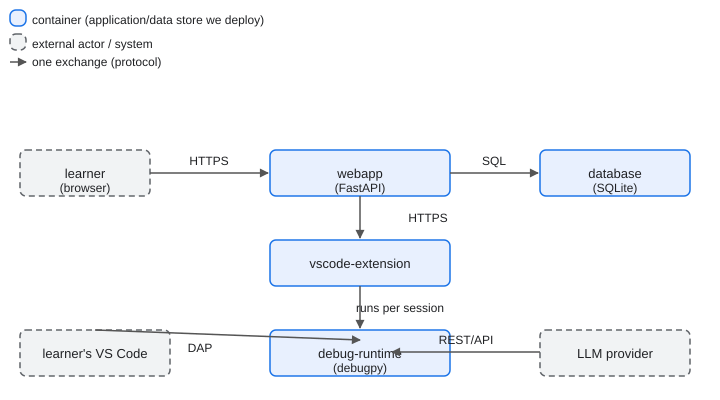

# Architecture

This document records the architecture of the Debugging Gym product, and [the product vision](../product-vision.md) is the scope it serves.

## Drivers

- **Business goals:** [the threshold of success](../threshold-of-success.md) holds the goals the architecture serves.
- **Constraints:** the product vision's [constraints section](../product-vision.md#constraints) holds the conditions the architecture lives inside.
- **Functional requirements:** the [functional requirements index](../functional-requirements/README.md) holds the behavior the architecture must deliver.
- **Quality requirements:** the [quality requirements index](../quality-requirements/README.md) holds the quality the architecture must meet, and it is also the priority matrix.

## Container View

The product runs as the containers below, and [`ADR-001`](adr/ADR-001.md) decides that split and the stack it runs on.

### Container Responsibilities

| Container | Responsibilities |
| --------- | ---------------- |
| `webapp` | Serves the catalogue and exercise generation; returns the attach configuration; accepts verification requests and coordinates official server-side verification; owns gallery requests and the session lifecycle |
| `debug-runtime` | Runs learner-submitted code and authoritative server-side verification tests in an isolated, resource-limited container; exposes a Debug Adapter Protocol server the learner's VS Code attaches to; owns uploaded source for the session lifetime |
| `database` | Stores the instructor-curated gallery and the results each learner records; owns problem metadata, authors, and result history |
| `vscode-extension` | Brings the choose, generate, task, and verify flow into VS Code; displays task instructions and verification feedback; manages the local exercise workspace and learner-accessible harness; calls the web application API for official verification |

## Diagrams And Legends

Solid boxes are the product's containers and dashed boxes are external actors or systems; an arrow is one exchange, labelled with the protocol or event that crosses it.
The image is [`container.svg`](./container.svg), and its Mermaid source is [`container.mmd`](./container.mmd), generated to match the diagram's containers and arrows.

## Architectural Decisions

| ADR | Status | Addresses | Decision |
| --- | ------ | --------- | -------- |
| [ADR-001](adr/ADR-001.md) | Accepted | [FR-001](../functional-requirements/fr/FR-001.md), [FR-002](../functional-requirements/fr/FR-002.md), [FR-003](../functional-requirements/fr/FR-003.md), [FR-004](../functional-requirements/fr/FR-004.md), [FR-005](../functional-requirements/fr/FR-005.md), [FR-006](../functional-requirements/fr/FR-006.md), [FR-007](../functional-requirements/fr/FR-007.md), [FR-008](../functional-requirements/fr/FR-008.md), [FR-010](../functional-requirements/fr/FR-010.md), [QR-02](../quality-requirements/qr/QR-02.md), [QR-03](../quality-requirements/qr/QR-03.md) | One webapp, a debug runtime, a database, and a VS Code extension |
| [ADR-002](adr/ADR-002.md) | Accepted | [FR-004](../functional-requirements/fr/FR-004.md), [QR-01](../quality-requirements/qr/QR-01.md) | Attach the learner's VS Code over the Debug Adapter Protocol |
| [ADR-003](adr/ADR-003.md) | Accepted | [FR-002](../functional-requirements/fr/FR-002.md), [QR-02](../quality-requirements/qr/QR-02.md) | Generate exercises with an LLM and a deterministic fallback |
| [ADR-004](adr/ADR-004.md) | Accepted | [FR-003](../functional-requirements/fr/FR-003.md), [FR-009](../functional-requirements/fr/FR-009.md) | Keep local harness feedback separate from official verification |
