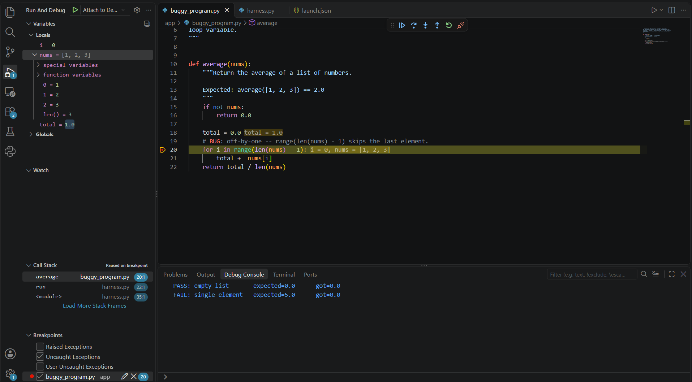

# Week 02 prototypes

This file records each prototype, what it tested, and what the customer said
about it. Prototype code stays off `main`; the evidence is this record and
screenshots, not a branch.

## Debugging a generated exercise in the learner's own VS Code

- **What it is:** a code spike, on a feature branch not merged to `main`: a
  minimal container running a buggy Python program with a harness, plus a
  Debug Adapter Protocol (DAP) bridge so the learner's VS Code can attach and
  hit breakpoints.
- **View:** 
- **Tested:** the `US-03` for "connect VS Code to the exercise environment"
  [US-03](https://github.com/Team8TemporaryName/Team8DebuggingGym/issues/22),
  and [`ASM-04`](../../docs/assumptions.md#asm-04) (safe
  user-attached debug sessions) and [`ASM-02`](../../docs/assumptions.md#asm-02)
  (learners will accept connecting their IDE).
- **Question:** can a learner attach their own VS Code to an exercise runtime
  we host and debug the buggy program with breakpoints and a harness result?
- **What the customer said:** the customer watched a live demo. VS Code
  attached to the container, hit breakpoints, and the harness reported the
  bug (the loop did not iterate all numbers) and then a pass once the fix was
  pushed. The customer confirmed the bug was real, that the harness signal was
  reasonable, and that remote debugging works: "it is possible to remotely
  debug." They raised follow-ups: how the locally-edited code gets pushed back
  to the server (not synced automatically in the prototype), keeping the
  harness non-modifiable, adding a task statement inside the IDE, and
  sandboxing/virtualization of the runtime.
- **What changed:** the prototype confirmed [DEC-004](../../docs/decisions.md#dec-004)
  (keep local debugging in the user's own IDE); the customer advised pulling
  the multi-language and gallery stories out of the minimal product
  ([DEC-005](../../docs/decisions.md#dec-005)) and keeping the harness
  non-modifiable ([DEC-006](../../docs/decisions.md#dec-006)). Auto-syncing
  edited code back to the server and guarding the harness became follow-ups
  for the next iteration.
