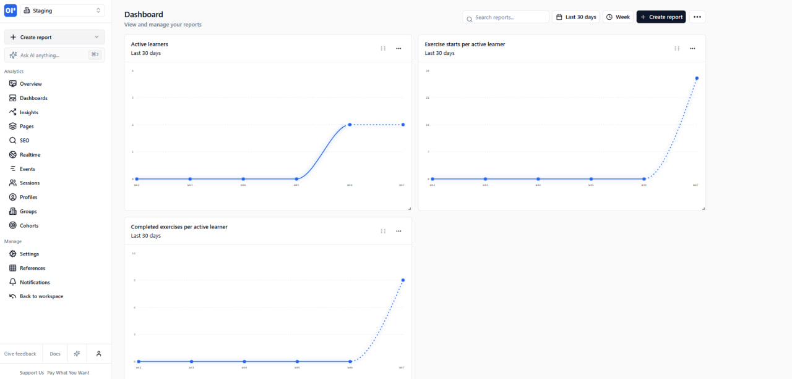
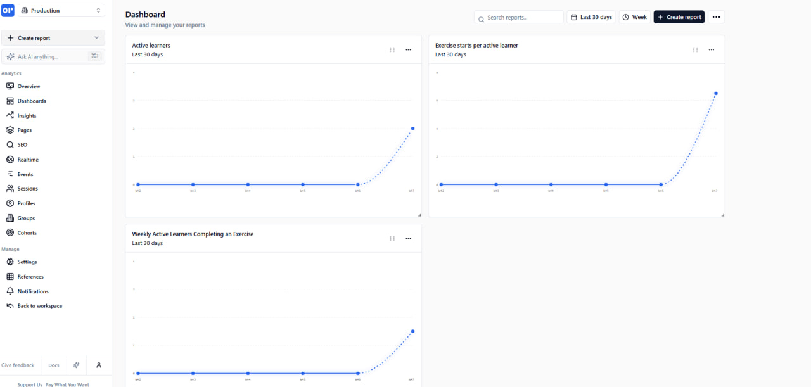
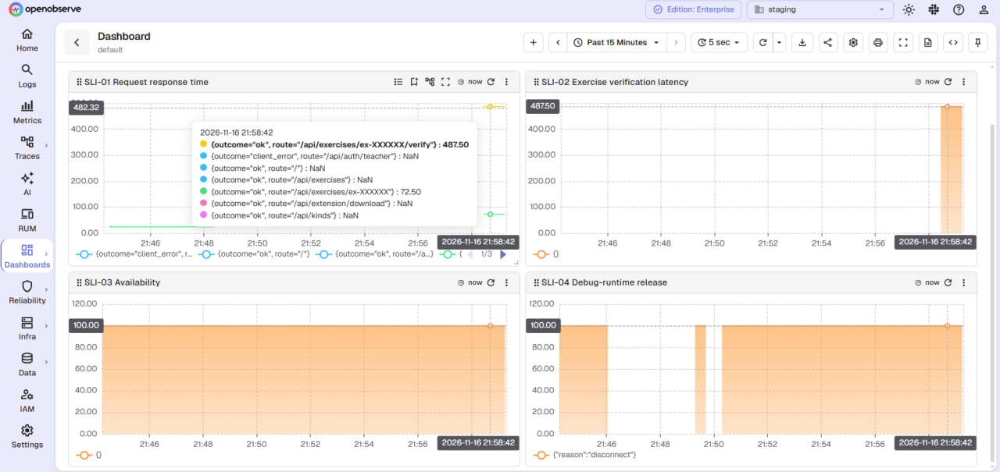
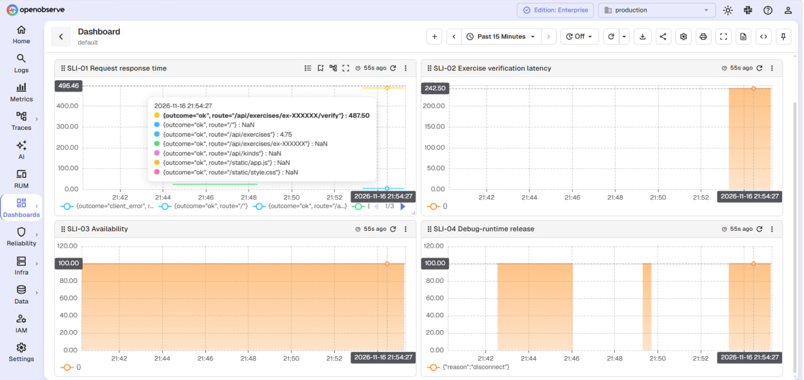

# Week 6 report — Product Review, Analytics, And Observability

**Project:** Debugging Gym · **Team:** 8 · **Week:** 6 · **Sprint:** SPRINT-06

## Summary

The customer review took place on **2026-11-09**. The team demonstrated the server-backed exercise workflow: teacher access and generation, learner browsing and retrieval, the VS Code extension download/reopen flow, local and server verification, and per-learner completion markers.

The sprint delivered the v0.6.0 release, published on **2026-11-20**. The Git tag points to the release commit on main (6b976cdca3ca0dc628d673ba51d04bccd33a78bb). The GitHub release and tag are real; the repository does not yet carry independent evidence that this exact commit was deployed to production and passed the production core-task check.

The customer-selected focus metric is **user satisfaction across learners and teachers**, measured through surveys. It has **no value yet**: the survey instrument, scale, sample, aggregation method, and success threshold must be finalized and collected during usability testing. The production analytics dashboard also contains the supporting **Weekly Active Learners Completing an Exercise** metric, calculated from distinct learner identifiers with exercise_completed events in a rolling seven-day window. The supporting metric is not a substitute for satisfaction.

The analytics and observability dashboards were not shown during the November 9 review because the university VM was unavailable then. The four environment dashboards were captured later and are linked below. The deployed **QR-05 QRT-01** was run in staging on **2026-11-19** and passed. The plan's [Quality Requirement Testing Plan](../../docs/project-plan.md#quality-requirement-testing-plan) remains the source for every test result that is not Passes; this report does not copy those rows.

The broader operator–teacher–learner workflow in TOS-05 remains follow-up work: account creation, exercise-set assignment, update reconciliation, submissions, and validated CSV export. Full account login is not a completed SPRINT-06 story; [US-18](https://github.com/Team8TemporaryName/Team8DebuggingGym/issues/89) remains in the unscheduled backlog.

## Threshold review

The table covers the four goals that were open when the November 9 review began. TOS-05 was added during that meeting and is recorded separately below.

| Goal | Current measure | New data can settle it? | Proposal |
| ---- | --------------- | ---------------------- | -------- |
| [TOS-01](../../docs/threshold-of-success.md#tos-01) | By the end of Week 9 (2026-11-28), a learner retrieves and opens a server-stored exercise through the VS Code extension, debugs and fixes it, submits it for server verification, and receives a verdict without needing the setup guide during ordinary use. | No. Analytics can show server-side exercise activity and completion, but cannot establish that the full extension workflow is usable without consulting setup instructions. | — |
| [TOS-02](../../docs/threshold-of-success.md#tos-02) | By the Week 6 review, the generated exercise contains the intended defect and the learner's fix receives a correct verification verdict. | No. This is established by exercise/harness correctness and retained-submission review, not by usage or operating telemetry. | — |
| [TOS-03](../../docs/threshold-of-success.md#tos-03) | By the Week 3 review, every story in the Week 2 candidate has a customer verdict: accepted or moved out of the candidate. | No. Telemetry cannot establish customer acceptance. | — |
| [TOS-04](../../docs/threshold-of-success.md#tos-04) | By the end of Week 3, a product user can reach the published product documentation without cloning the repository. | Partly. A reachability check can show that the site responds, but not whether the intended user can find and use it. | — |

- **[TOS-01](../../docs/threshold-of-success.md#tos-01) — Open:** the customer asked to restate the core task around the current extension-based flow; see [DEC-027](../../docs/decisions.md#dec-027).
- **[TOS-02](../../docs/threshold-of-success.md#tos-02) — Achieved:** the customer accepted the correctness threshold under the revised retained-submission audit model; see [DEC-035](../../docs/decisions.md#dec-035) and [DEC-036](../../docs/decisions.md#dec-036).
- **[TOS-03](../../docs/threshold-of-success.md#tos-03) — Achieved:** the customer had accepted the Week 2 candidate and confirmed that the team should continue from it; see [DEC-005](../../docs/decisions.md#dec-005).
- **[TOS-04](../../docs/threshold-of-success.md#tos-04) — Achieved:** the customer opened the documentation site and confirmed it was reachable, requesting neutral “product user” wording; see [DEC-037](../../docs/decisions.md#dec-037).
- **[TOS-05](../../docs/threshold-of-success.md#tos-05) — Open (new):** the customer added the operator–teacher–learner classroom scenario, including validated results export; see [DEC-028](../../docs/decisions.md#dec-028).

The team proposed no new numerical analytics measure for these goals. TOS-01 is an end-to-end usability and task-completion condition; TOS-02 and TOS-03 were settled by direct verification and customer acceptance; TOS-04 was settled by the customer's reachability check; and the TOS-05 workflow is not yet implemented or instrumented end to end. The customer separately selected satisfaction as the focus metric and asked the team to define its survey measure after usability testing ([DEC-029](../../docs/decisions.md#dec-029)); “four out of five satisfied” was an example, not an agreed target.

## Customer review outcomes

The meeting report records the demonstrated increment and the customer's decisions, but it does not contain a separate accept/reject verdict for every individual story. We therefore report what was demonstrated and do not invent per-story acceptance decisions.

| Story | Review outcome |
| ----- | -------------- |
| [US-13 — server-stored exercises](https://github.com/Team8TemporaryName/Team8DebuggingGym/issues/84) | Demonstrated through exercise persistence, retrieval, and server verification. |
| [US-14 — teacher/student interfaces](https://github.com/Team8TemporaryName/Team8DebuggingGym/issues/85) | Teacher access-key flow demonstrated; full account login remains later work. |
| [US-15 — teacher exercise generation](https://github.com/Team8TemporaryName/Team8DebuggingGym/issues/86) | Teacher prompt-based generation with a name and description demonstrated. |
| [US-16 — browse and solve exercises](https://github.com/Team8TemporaryName/Team8DebuggingGym/issues/87) | Learner browsing, reopening, and solving server-stored exercises demonstrated. |
| [US-17 — extension download](https://github.com/Team8TemporaryName/Team8DebuggingGym/issues/88) | Extension download and the reopen flow demonstrated. |
| [US-19 — completion tracking](https://github.com/Team8TemporaryName/Team8DebuggingGym/issues/90) | Per-learner completion marker demonstrated after successful server verification. |
| [US-20 — product analytics](https://github.com/Team8TemporaryName/Team8DebuggingGym/issues/91) | Dashboards were not shown during the meeting because the VM was unavailable; dashboard evidence was captured later. |
| [US-21 — operational observability](https://github.com/Team8TemporaryName/Team8DebuggingGym/issues/92) | Dashboards and the deployed QRT were not shown during the meeting; QR-05 QRT-01 was run later in staging. |

## Dashboard evidence

### Product analytics

The staging screenshot shows the staging OpenPanel scope and event-derived learner activity charts. The production screenshot shows the production scope, including the supporting weekly-active-learner completion metric. Neither dashboard measures the customer-selected survey-based satisfaction focus metric.

### Operational observability

The staging and production OpenObserve dashboards show their respective environment scopes and the configured SLI panels. The charts are evidence that the dashboards render telemetry; they are not evidence that every underlying quality requirement passes. In particular, SLI-03 is an application-side HTTP request-success indicator, not the independent external availability monitor required by QR-04. SLI-04 remains Planned and its chart must not be treated as proof of remote debug-runtime shutdown and source deletion.

The separate [QR-05 QRT-01 staging evidence](qr-05-qrt-01-evidence.md) records the deliberate failed verification request, its request_id, route and client_error outcome, the 0.30-second log detection, and the 4.750 ms SLI-01 five-minute P95. The [dedicated OpenObserve QRT screenshot](images/qr-05-qrt-01-staging-openobserve-dashboard.png) is the test evidence; it is not a substitute for the two environment dashboard screenshots above.

## Coverage table

| Deliverable | Artifact |
| ----------- | -------- |
| Sprint plan and new stories | [docs/project-plan.md#sprint-06](../../docs/project-plan.md#sprint-06), with [US-20](https://github.com/Team8TemporaryName/Team8DebuggingGym/issues/91) and [US-21](https://github.com/Team8TemporaryName/Team8DebuggingGym/issues/92) |
| Analytics plan | [docs/analytics.md](../../docs/analytics.md), including the focus metric and supporting metric tree |
| Events and instrumentation | [docs/analytics.md#event-schema](../../docs/analytics.md#event-schema) |
| Analytics dashboards | [reports/week-06/images/analytics-staging.jpg](images/analytics-staging.jpg) and [reports/week-06/images/analytics-production.jpg](images/analytics-production.jpg) |
| Observability plan and SLIs | [docs/observability.md](../../docs/observability.md) |
| Observability dashboards | [reports/week-06/images/observability-staging.jpg](images/observability-staging.jpg) and [reports/week-06/images/observability-production.jpg](images/observability-production.jpg) |
| Feature documentation | [docs/features.md](../../docs/features.md) |
| Functional requirements | [docs/functional-requirements/README.md](../../docs/functional-requirements/README.md), including FR-016 and FR-017 |
| ADRs and container view | [docs/architecture/adr/README.md](../../docs/architecture/adr/README.md) and [docs/architecture/README.md#container-view](../../docs/architecture/README.md#container-view) |
| Observability requirement | [docs/quality-requirements/qr/QR-05.md](../../docs/quality-requirements/qr/QR-05.md), including QRT-01 |
| Runtime test re-run | [docs/project-plan.md#quality-requirement-testing-plan](../../docs/project-plan.md#quality-requirement-testing-plan) and [automated QRT evidence](qr-02-qr-03-automated-qrt-evidence.md) |
| Threshold review | [reports/week-06/README.md#threshold-review](#threshold-review) |
| Week 5 action points | [reports/week-06/meeting-report.md#previous-action-points](meeting-report.md#previous-action-points) |
| Week 5 open questions | [reports/week-06/meeting-report.md#previous-open-questions](meeting-report.md#previous-open-questions) |
| Meeting script | [reports/week-06/meeting-script.md](meeting-script.md) |
| Meeting transcript | [reports/week-06/meeting-transcript.md](meeting-transcript.md) |
| Customer validation | [reports/week-06/meeting-report.md](meeting-report.md) and [DEC-029](../../docs/decisions.md#dec-029) |
| REL-06 | [v0.6.0 tag and release](https://github.com/Team8TemporaryName/Team8DebuggingGym/releases/tag/v0.6.0), [CHANGELOG.md#060---2026-11-20](../../CHANGELOG.md#060---2026-11-20), and [docs/project-plan.md#rel-06](../../docs/project-plan.md#rel-06) |
| Sprint retrospective | [reports/week-06/sprint-retrospective.md](sprint-retrospective.md) |
| AI usage | [reports/week-06/ai-usage.md](ai-usage.md) |

## Contributions

| GitHub username | Work recorded for this sprint |
| --------------- | ----------------------------- |
| [Magel0n](https://github.com/Magel0n) | Server-backed exercise and progress stories ([US-13–US-16](https://github.com/Team8TemporaryName/Team8DebuggingGym/issues/84), [US-19](https://github.com/Team8TemporaryName/Team8DebuggingGym/issues/90)); corrected SLI measurements ([PR #99](https://github.com/Team8TemporaryName/Team8DebuggingGym/pull/99)); staging diagnosability QRT ([PR #103](https://github.com/Team8TemporaryName/Team8DebuggingGym/pull/103)); plan, threshold, and report closeout ([PR #98](https://github.com/Team8TemporaryName/Team8DebuggingGym/pull/98), [PR #104](https://github.com/Team8TemporaryName/Team8DebuggingGym/pull/104)). |
| [Tedor49](https://github.com/Tedor49) | Extension download story ([US-17](https://github.com/Team8TemporaryName/Team8DebuggingGym/issues/88)); final dashboard documentation and screenshots ([PR #102](https://github.com/Team8TemporaryName/Team8DebuggingGym/pull/102)). |
| [Doosuur14](https://github.com/Doosuur14) | Analytics instrumentation and OpenPanel dashboards ([US-20](https://github.com/Team8TemporaryName/Team8DebuggingGym/issues/91), [PR #94](https://github.com/Team8TemporaryName/Team8DebuggingGym/pull/94)). |
| [NikitaRUniverse](https://github.com/NikitaRUniverse) | Observability signals and OpenObserve dashboards ([US-21](https://github.com/Team8TemporaryName/Team8DebuggingGym/issues/92), [PR #95](https://github.com/Team8TemporaryName/Team8DebuggingGym/pull/95)). |

## Repository evidence

- [PR #103](https://github.com/Team8TemporaryName/Team8DebuggingGym/pull/103) merged and closed its task, [Issue #81](https://github.com/Team8TemporaryName/Team8DebuggingGym/issues/81).
- [PR #104](https://github.com/Team8TemporaryName/Team8DebuggingGym/pull/104) merged the customer-review and threshold changes and closed [Issue #82](https://github.com/Team8TemporaryName/Team8DebuggingGym/issues/82).
- The latest required checks on main are green on commit 6b976cdca3ca0dc628d673ba51d04bccd33a78bb: [Lychee link check](https://github.com/Team8TemporaryName/Team8DebuggingGym/actions/runs/44815252758), [Markdown check](https://github.com/Team8TemporaryName/Team8DebuggingGym/actions/runs/44815252719), [Actionlint](https://github.com/Team8TemporaryName/Team8DebuggingGym/actions/runs/44815252692), and [Product code CI](https://github.com/Team8TemporaryName/Team8DebuggingGym/actions/runs/44815252696). Product CI passed Ruff linting/formatting, the VS Code extension type-check/build, and the automated Python and browser tests.
- The [documentation deployment](https://github.com/Team8TemporaryName/Team8DebuggingGym/actions/runs/44815252726) also completed successfully on that commit.

## Deviations

- The November 9 review could not show the university-VM dashboards or deployed observability QRT because the VM was unavailable at the meeting. The analytics and observability screenshots were captured later; QR-05 QRT-01 passed in staging on November 19. These later results are not described as part of the November 9 demonstration.
- The four dashboard screenshots are JPEG files (.jpg) rather than the .png filenames used in the assignment's example paths. The original image format was retained; the four images were visually inspected and show environment labels without visible credentials, tokens, or private host addresses.
- QR-03 QRT-04 (remote debug-runtime shutdown and source deletion) and QR-04 QRT-05 (independent external availability monitoring over seven days) remain Not verified. The local cleanup tests and the application-side SLI-03 request-success panel do not prove those requirements.
- The focus metric has no value yet because the customer deferred the survey instrument and numerical threshold until usability testing.
- The GitHub v0.6.0 tag and release are published and the tag points to the current main release commit. The release body still needs the operator-facing upgrade note required by the course. The repository also does not contain verifiable evidence that the production deployment ran this exact commit and passed the core-task check.
- The private Moodle PDF and repository snapshot are intentionally left outside this GitHub closeout task; they must be uploaded separately using the final merged main commit.
- No private-only dashboard addresses, credentials, tokens, or other private-only material were added to this report or its linked screenshots.
