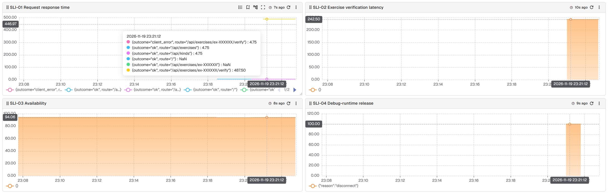

# QR-05 QRT-01 — Staging execution evidence

- **Result:** Passed
- **Execution date:** 2026-11-19
- **Environment:** Staging
- **Execution location:** University network
- **Command:** `python scripts/check_sli.py`
- **Staging application revision:** `9e9cc89e3cb8ed2fe7a854dcfba1a2b852e24e14`
- **Exercise:** Existing staging exercise `ex-288701` (reused; no exercise was generated and no LLM provider was called).

The staging revision above was read on the staging VM using `git -C ~/staging_app rev-parse HEAD`. The operator confirmed that no application functionality affecting this QRT had changed since that revision was deployed.

## Observed result

| Check | Observed value | Acceptance threshold |
| --- | --- | --- |
| Deliberate verification request | HTTP 400 — missing `source` | HTTP 400 expected |
| Request ID | `41bcafe68b046f19` | Response includes `x-request-id` |
| Log stream | `default` | Staging log point queryable |
| Log request ID | `41bcafe68b046f19` | Must match response request ID |
| Log route | `/api/exercises/ex-288701/verify` | Verification route |
| Log outcome | `client_error` | Failure outcome |
| Log point detection | 0.30 seconds after response | Within 5 seconds |
| SLI-01 series outcome | `client_error` | Failure series |
| SLI-01 route | Verification route (`/api/exercises/<exercise_id>/verify`) | Verification route |
| SLI-01 five-minute P95 | 4.750 ms | Finite numeric value |
| SLI-01 series detection | 2.89 seconds after response | Within 60 seconds |
| Overall result | **PASS** | All QRT-01 response measures met |

The SLI-01 check evaluated the existing five-minute P95 expression unchanged:

```promql
histogram_quantile(0.95, sum by (le, route, outcome) (rate(request_duration_ms_bucket[5m])))
```

The QRT uses the Prometheus-compatible range-query endpoint to observe a finite evaluation sample at or after the deliberate response; this does not change the SLI definition or its PromQL expression.

## Sanitized command output

```text
python scripts/check_sli.py
QR-05 QRT-01 — staging diagnosability check
Environment: staging
Deliberate verification response: HTTP 400 (missing source)
Request ID: 41bcafe68b046f19
OpenObserve log stream: default
Log request ID: 41bcafe68b046f19
Log route: /api/exercises/ex-288701/verify
Log outcome: client_error
Log point found after response: 0.30s (deadline: 5s)
SLI-01 failure route: /api/exercises/XXXXXX/verify
SLI-01 outcome: client_error
SLI-01 five-minute P95: 4.750 ms
SLI-01 series found after response: 2.89s (deadline: 60s)
Result: PASS — the QR-05 response measures were met.
```

Private staging addresses, organization identifiers, usernames, passwords, tokens, and private configuration values are intentionally omitted.

## Dashboard evidence

The screenshot below is the staging OpenObserve dashboard captured on 2026-11-19. The SLI-01 tooltip shows the `client_error` verification route and the 4.75 ms P95 value. The exercise identifier in the screenshot's route label is masked; the exact route is recorded in the script output above.


